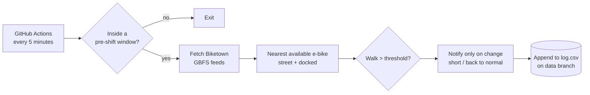

# Biketown Alert

I commute around Portland on Biketown e-bikes. Usually there's one a minute or two from my apartment, but sometimes the nearest bike is 10+ minutes away, and I only find out as I'm walking out the door. Then I'm late.

This checks Biketown's live data before each of my work shifts and sends a push notification to my phone when the nearest e-bike is farther than usual, early enough that I can leave sooner. It also logs every check, so over time I can see when and how often bikes run short near me.

## How it works



1. **Schedule.** A GitHub Actions workflow runs every 5 minutes, but the script exits immediately unless it's inside the check window before a shift (for example, from 45 minutes before I leave until I leave).
2. **Live data.** Biketown publishes real-time availability through [GBFS](https://github.com/MobilityData/gbfs), the open bikeshare data standard. Free-floating bikes come with their own coordinates; bikes docked at stations are matched to station locations.
3. **Filtering.** Reserved bikes, disabled bikes, and scooters are skipped.
4. **Walking time.** Straight-line distance (haversine formula) times a 1.3 detour factor for city streets, at a walking pace of 80 m per minute.
5. **Notifications** through [ntfy](https://ntfy.sh). To avoid buzzing every 5 minutes, it only notifies when the situation *changes*: once when bikes become scarce, and once if they come back before I leave. Tapping the notification opens walking directions to the nearest bike.
6. **Logging.** Every check during a window is appended to `log.csv` on a separate `data` branch, along with the alert state, so the main branch history stays clean.

## Privacy

The repo is public, but nothing personal is in it:

- Home coordinates, the ntfy topic, and my shift schedule are stored as GitHub Actions secrets.
- The log records walking time and distance, never coordinates or station names. Its timestamps do show roughly when checks run, and so roughly when my shifts are.

## Setup

1. Fork or clone this repo.
2. Install the [ntfy app](https://ntfy.sh) and subscribe to a long random topic name (anyone who knows the name can read it).
3. In the repo's **Settings → Secrets and variables → Actions**, add these **secrets**:

   | Secret | Example |
   |---|---|
   | `HOME_LAT` | `45.51897` |
   | `HOME_LON` | `-122.67930` |
   | `NTFY_TOPIC` | `biketown-7f3k2q9x` |
   | `SHIFTS` | `Mon 07:00`, `Wed 15:00`, `2026-10-24 23:00` (one per line) |

   Weekly shifts use a day name and a 24-hour time. One-time shifts use a date.

4. Optional **variables** (same page, Variables tab):

   | Variable | Default | Meaning |
   |---|---|---|
   | `THRESHOLD_MINUTES` | `3` | Alert when the nearest e-bike is a longer walk than this |
   | `COMMUTE_MINUTES` | `10` | How long before a shift starts I leave home |
   | `LEAD_MINUTES` | `45` | How long before leaving the checks begin |

5. On the **Actions** tab, open **Check bikes** and click **Run workflow**. A manual run skips the schedule and always sends a test notification.

GitHub sometimes starts scheduled runs a few minutes late when it's busy, so this is a heads-up, not a to-the-minute alarm.

## Running locally

Only the Python standard library is needed (3.10+).

```bash
python -m unittest discover tests

HOME_LAT=45.51897 HOME_LON=-122.67930 NTFY_TOPIC=your-topic FORCE_CHECK=true \
  python -m bikealert.main --data-dir data
```

## Project structure

```
bikealert/
  config.py   settings from environment variables
  bikes.py    GBFS feeds, filtering, haversine distance, nearest bike
  shifts.py   shift schedule parsing and pre-shift check windows
  notify.py   ntfy push notifications
  main.py     one check: decide, notify on change, log
tests/        unit tests with hand-made feeds shaped like the real ones
.github/workflows/
  check.yml   the 5-minute schedule
  tests.yml   runs the tests on every push
```

## Ideas

- Analyze the log: which days and times bikes run short, and whether it's getting better or worse.
- Pull shifts straight from Google Calendar instead of a list.
- Use real walking routes instead of a detour estimate.
